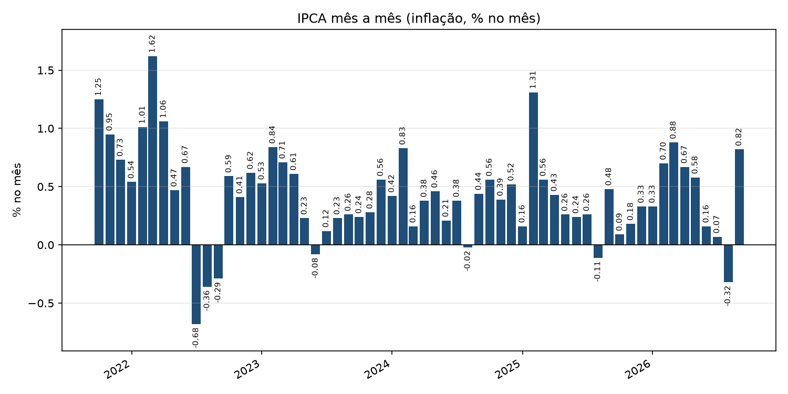
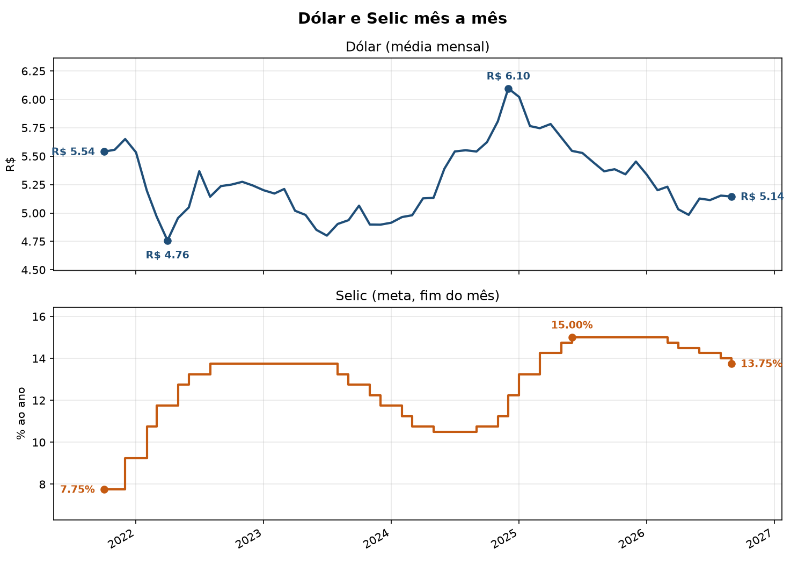

# brazil-economic-indicators-etl


🇬🇧 English | [🇧🇷 Português](#-português)

A simple, beginner-friendly **ETL (Extract, Transform, Load) pipeline** in Python. It collects three key Brazilian economic indicators from the Brazilian Central Bank (BCB) open data API and combines them into a **single, analysis-ready monthly table**, saved as Excel and CSV.

## 🇬🇧 English

### What it does

| Indicator | Description | In the final table |
|---|---|---|
| **USD/BRL** | US dollar exchange rate in Brazilian reais (daily) | `dolar`: monthly average |
| **Selic** | Selic target rate set by Copom, % per year (daily) | `selic`: value at the end of the month |
| **IPCA** | Consumer price inflation, % per month (monthly) | `ipca`: monthly variation |

By default it fetches the **last 5 years**, up to today.

### How it works

```
Extract  →  Transform  →  Load
 BCB API     clean, convert,    Excel + CSV
 (3 series)  summarize by month (data/ folder)
```

1. **Extract** (`extract.py`): fetches the three series from the BCB SGS open data API.
2. **Transform** (`transform.py`): converts text to dates and numbers, summarizes each series to one row per month and joins them into one table.
3. **Load** (`load.py`): saves the final table as a formatted Excel file and as a CSV.
4. **Entry point** (`main.py`): runs the three steps in order, calculating the dates automatically, and then draws two example charts (`grafico_ipca.py` and `grafico_dolar_selic.py`).

### Getting started

**Requirements:** Python 3.10 or higher and Git.

```bash
# 1. Clone the repository
git clone https://github.com/PabloSantosdve/brazil-economic-indicators-etl.git
cd brazil-economic-indicators-etl

# 2. Create and activate a virtual environment
python -m venv .venv
# Windows (PowerShell):
.venv\Scripts\Activate.ps1
# Linux / macOS:
source .venv/bin/activate

# 3. Install the dependencies
pip install -r requirements.txt

# 4. Run the pipeline
python main.py
```

> **Windows tip:** if PowerShell blocks the activation script, run
> `Set-ExecutionPolicy -Scope CurrentUser -ExecutionPolicy RemoteSigned` once and try again.

### Output

Running `python main.py` creates a `data/` folder with two files:

- `indicadores_mensais.xlsx`: formatted spreadsheet (`R$` for the dollar, `%` for IPCA and Selic).
- `indicadores_mensais.csv`: plain CSV, dates as `yyyy-mm-dd`.

It also saves two chart images (`grafico_ipca.png` and `grafico_dolar_selic.png`) in the project root, see [Examples](#examples).

Both data files have the same columns:

| Column | Meaning |
|---|---|
| `data` | Month (first day of the month) |
| `ipca` | IPCA inflation, % in the month |
| `selic` | Selic target rate, % per year, at the end of the month |
| `dolar` | USD/BRL, monthly average |

### Examples

`python main.py` already draws both charts and saves them as PNG images. To generate just one of them from the CSV (run `python main.py` at least once first), use the scripts below.

**Inflation month by month** (IPCA of each month, one bar per month):

```bash
python grafico_ipca.py
```



**USD/BRL and Selic** (two stacked charts sharing the same months, so you can compare *when* each one rose or fell without a shared scale suggesting a relationship):

```bash
python grafico_dolar_selic.py
```



### Running the tests

```bash
python -m pytest
```

Run it from the project root. The tests cover the Transform step (type conversion, sorting, invalid values and invalid dates, and the monthly table).

### Good to know

- **The table ends at the last month where all three series are available.** IPCA is published with a delay, so the most recent month (and the month in progress) is left out until the data exists. Run the pipeline again later and the new month appears on its own.
- **Choices made for the monthly summary:** the dollar uses the monthly average (smooths daily swings); Selic and IPCA use the last value of the month (Selic is a "step" that changes only at Copom meetings).
- To change how many years it fetches, edit `ANOS_DE_HISTORICO` in `main.py`.

### Project structure

```
brazil-economic-indicators-etl/
├── main.py            # entry point: runs Extract, Transform, Load and the charts
├── extract.py         # fetches the series from the BCB API
├── transform.py       # cleans, summarizes by month and joins the series
├── load.py            # saves the table as Excel and CSV
├── grafico_ipca.py    # example: IPCA bar chart from the CSV
├── grafico_dolar_selic.py  # example: USD/BRL and Selic charts from the CSV
├── tests/             # automated tests (run with: python -m pytest)
├── requirements.txt   # Python dependencies
└── data/              # generated files (created when you run the pipeline)
```

### Roadmap

- [x] Define project goals and data sources
- [x] Create repository
- [x] Extract: fetch the three series from the API
- [x] Transform: clean, convert, summarize by month and join
- [x] Load: save to Excel and CSV
- [x] Entry point with automatic dates
- [x] Basic tests for the transform step
- [x] Example analysis: inflation (IPCA) month by month
- [x] Example analysis: USD/BRL vs. Selic

### Data source

Data from the [Banco Central do Brasil (BCB)](https://dadosabertos.bcb.gov.br/) open data portal, SGS series 1 (USD/BRL), 432 (Selic target) and 433 (IPCA). Please check the portal for the current terms of use.

### License

This project is licensed under the MIT License. See the [LICENSE](LICENSE) file.

---

## 🇧🇷 Português

Um **pipeline ETL (Extract, Transform, Load)** simples em Python, pensado para quem está começando. Ele coleta três indicadores econômicos brasileiros na API de dados abertos do Banco Central do Brasil (BCB) e os reúne em **uma única tabela mensal, pronta para análise**, salva em Excel e CSV.

### O que ele faz

| Indicador | Descrição | Na tabela final |
|---|---|---|
| **USD/BRL** | Cotação do dólar em reais (diária) | `dolar`: média do mês |
| **Selic** | Meta da Selic definida pelo Copom, % ao ano (diária) | `selic`: valor no fim do mês |
| **IPCA** | Inflação ao consumidor, % no mês (mensal) | `ipca`: variação do mês |

Por padrão, busca os **últimos 5 anos**, até hoje.

### Como funciona

```
Extract  →  Transform  →  Load
 API BCB     limpar, converter,  Excel + CSV
 (3 séries)  resumir por mês     (pasta data/)
```

1. **Extract** (`extract.py`): busca as três séries na API de dados abertos SGS do BCB.
2. **Transform** (`transform.py`): converte textos em datas e números, resume cada série para uma linha por mês e junta tudo numa tabela.
3. **Load** (`load.py`): salva a tabela final em Excel formatado e em CSV.
4. **Ponto de entrada** (`main.py`): roda as três etapas em ordem, calculando as datas automaticamente, e depois desenha dois gráficos de exemplo (`grafico_ipca.py` e `grafico_dolar_selic.py`).

### Como usar

**Requisitos:** Python 3.10 ou superior e Git.

```bash
# 1. Clone o repositório
git clone https://github.com/PabloSantosdve/brazil-economic-indicators-etl.git
cd brazil-economic-indicators-etl

# 2. Crie e ative um ambiente virtual
python -m venv .venv
# Windows (PowerShell):
.venv\Scripts\Activate.ps1
# Linux / macOS:
source .venv/bin/activate

# 3. Instale as dependências
pip install -r requirements.txt

# 4. Rode o pipeline
python main.py
```

> **Dica para Windows:** se o PowerShell bloquear o script de ativação, rode uma vez
> `Set-ExecutionPolicy -Scope CurrentUser -ExecutionPolicy RemoteSigned` e tente de novo.

### Resultado

Ao rodar `python main.py`, é criada a pasta `data/` com dois arquivos:

- `indicadores_mensais.xlsx`: planilha formatada (`R$` no dólar, `%` no IPCA e na Selic).
- `indicadores_mensais.csv`: CSV simples, com datas no formato `aaaa-mm-dd`.

Ele também salva duas imagens de gráficos (`grafico_ipca.png` e `grafico_dolar_selic.png`) na pasta raiz do projeto, veja [Exemplos](#exemplos).

Os dois arquivos de dados têm as mesmas colunas:

| Coluna | Significado |
|---|---|
| `data` | Mês (primeiro dia do mês) |
| `ipca` | Inflação IPCA, % no mês |
| `selic` | Meta da Selic, % ao ano, no fim do mês |
| `dolar` | USD/BRL, média do mês |

### Exemplos

O `python main.py` já desenha os dois gráficos e salva as imagens em PNG. Para gerar só um deles a partir do CSV (rode o `python main.py` pelo menos uma vez antes), use os scripts abaixo.

**Inflação mês a mês** (IPCA de cada mês, uma barra por mês):

```bash
python grafico_ipca.py
```


**Dólar e Selic** (dois gráficos empilhados com os mesmos meses, para comparar *quando* cada um subiu ou caiu sem que uma escala comum sugira uma relação):

```bash
python grafico_dolar_selic.py
```


### Rodando os testes

```bash
python -m pytest
```

Rode na pasta raiz do projeto. Os testes cobrem a etapa Transform (conversão de tipos, ordenação, valores inválidos, datas inválidas e a tabela mensal).

### Bom saber

- **A tabela termina no último mês em que as três séries estão disponíveis.** O IPCA é divulgado com atraso, então o mês mais recente (e o mês em andamento) fica de fora até o dado existir. Rode o pipeline de novo mais tarde e o mês novo aparece sozinho.
- **Escolhas do resumo mensal:** o dólar usa a média do mês (suaviza as oscilações do dia a dia); a Selic e o IPCA usam o último valor do mês (a Selic é um "degrau" que só muda nas reuniões do Copom).
- Para mudar quantos anos são buscados, edite `ANOS_DE_HISTORICO` no `main.py`.

### Estrutura do projeto

```
brazil-economic-indicators-etl/
├── main.py            # ponto de entrada: roda Extract, Transform, Load e os gráficos
├── extract.py         # busca as séries na API do BCB
├── transform.py       # limpa, resume por mês e junta as séries
├── load.py            # salva a tabela em Excel e CSV
├── grafico_ipca.py    # exemplo: gráfico do IPCA a partir do CSV
├── grafico_dolar_selic.py  # exemplo: gráficos de dólar e Selic a partir do CSV
├── tests/             # testes automáticos (rode: python -m pytest)
├── requirements.txt   # dependências Python
└── data/              # arquivos gerados (criada ao rodar o pipeline)
```

### Roteiro

- [x] Definir objetivos e fontes de dados
- [x] Criar o repositório
- [x] Extract: buscar as três séries na API
- [x] Transform: limpar, converter, resumir por mês e juntar
- [x] Load: salvar em Excel e CSV
- [x] Ponto de entrada com datas automáticas
- [x] Testes básicos da etapa Transform
- [x] Exemplo de análise: inflação (IPCA) mês a mês
- [x] Exemplo de análise: dólar × Selic


### Fonte dos dados

Dados do portal de dados abertos do [Banco Central do Brasil (BCB)](https://dadosabertos.bcb.gov.br/), séries SGS 1 (USD/BRL), 432 (meta Selic) e 433 (IPCA). Consulte o portal para conferir os termos de uso atuais.

### Licença

Este projeto está sob a licença MIT. Veja o arquivo [LICENSE](LICENSE).